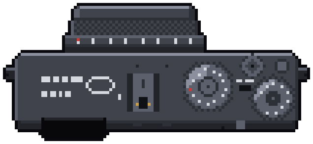
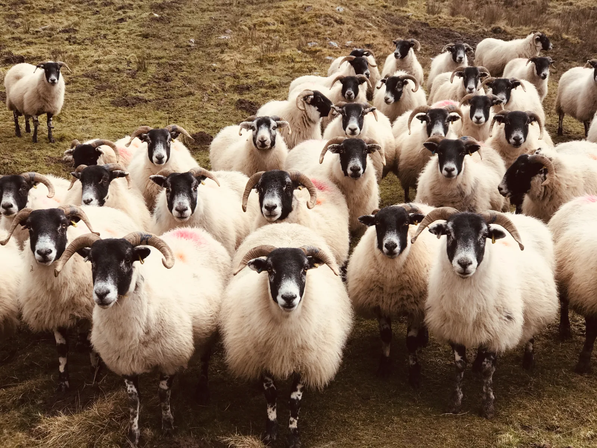

### No more excuses. I’ve bought a ‘proper’ camera.

After years of happy snapping, I’ve finally taken the plunge, hoping that a little more creative control will help raise my game.



I’ve been carrying a camera around with me since my early teens (I’m retired now!), but have never really taken photography too seriously. Now that I have time, I'm going to explore it in a bit more depth and see what I can achieve. 

There’s something about spotting, or anticipating, that ‘decisive moment’ that gives me a real buzz. Capturing it in an image is the icing on the cake.

Until now, photography has largely been something I’ve done alongside other activities – hiking, cycling and travelling, for example. As a result, family, landscapes, wildlife and the great outdoors have always featured heavily in my pictures.

More recently, my curiosity has been piqued by street photography and the clever ways it captures and documents everyday life.

I’m really looking forward to exploring these different genres, developing my technical and creative skills and, above all, having fun along the way.

I hope you enjoy following my photographic journey as I explore new subjects and gradually discover my own style.

Feel free to have a browse and offer any thoughts or advice. I’m always keen to learn (and constructive criticism is welcome, however painful 😜).



```{=html}
<!-- <div class="about-tools">
  <h2>Tools of the trade</h2>
  <figure>
    
    <figcaption>Fujifilm X100VI</figcaption>
  </figure>
</div> -->

```
