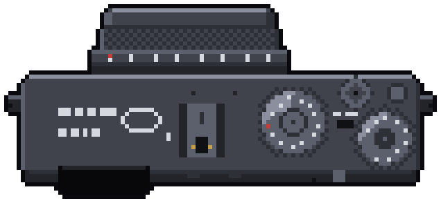

Hiking, cycling, travel and curiosity provide plenty of photographic opportunities.

This website brings together my images, projects and blog as I explore and develop my photography.

```{=html}
<div class="about-tools">
  <h2>Tools of the trade</h2>
  <figure>
    
    <figcaption>Fujifilm X100VI</figcaption>
  </figure>
</div>

<!-- Email address is stored reversed + base64 and only assembled on click, so it never appears in the page source. -->
<script>
document.querySelectorAll('a.about-link[href$="#email"]').forEach(a => a.addEventListener('click', e => {
  e.preventDefault();
  const addr = atob('bW9jLmR1b2xjaUBxNS5zcmlhaGNfbmlyaXBzYQ==').split('').reverse().join('');
  location.href = 'mailto:' + addr + '?subject=' + encodeURIComponent('Visitor Query: garrysykes.com');
}));
</script>
```
