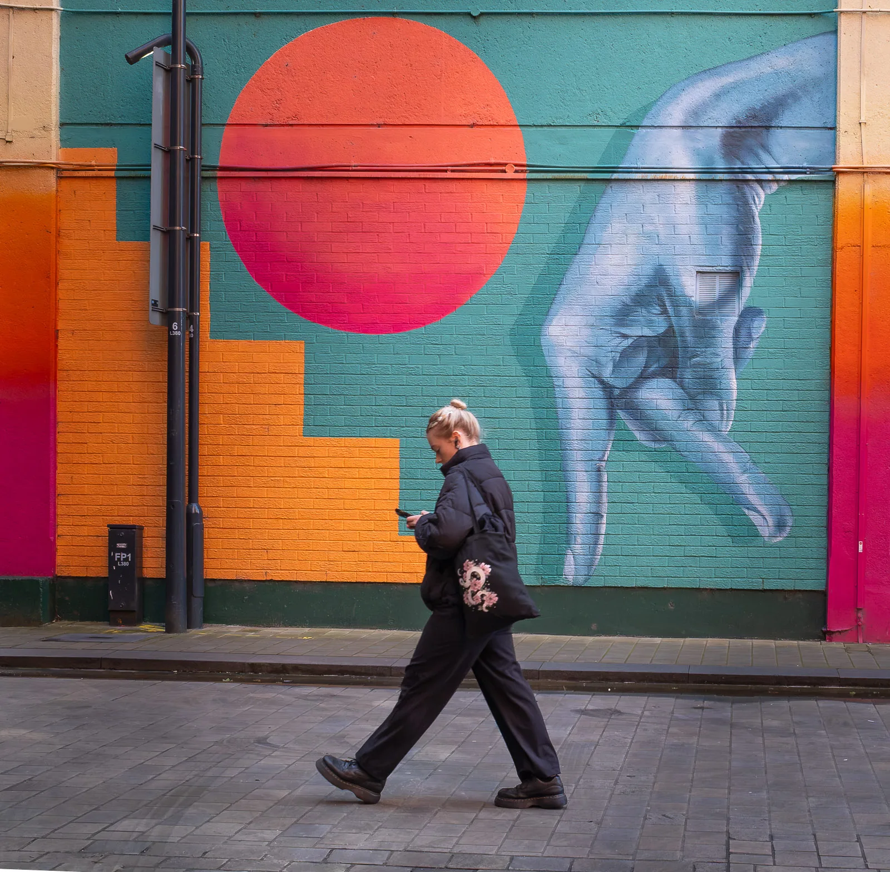

If I tried to explain my interest in [street photography](https://en.wikipedia.org/wiki/Street_photography) to family or friends, I’d probably be met with a blank expression or an eye roll. It would confirm, beyond a shadow of a doubt, that I’m as weird and dysfunctional as they suspected. C’est la vie!

For me, street photography ticks a few boxes.

Firstly, I get to leave my nice, quiet, suburban village for a few hours and immerse myself in the grittiness, vibrancy and energy of the inner city.

Secondly, I get to observe, anticipate and problem-solve. Where is the sunlight going to cast its shadows? How can I position myself to capture the man with the maroon hat? What would make a great backdrop for a passing cyclist?

>  “Street life, you can run away from time”
>
>  — [Street Life](https://www.youtube.com/watch?v=IpMN3DYgTP8&list=RDIpMN3DYgTP8&start_radio=1), The Crusaders

Thirdly, I get to geek out with a piece of technological wizardry that offers almost infinite creative possibilities.

And lastly, with a dash of planned serendipity, I get to capture that elusive ‘decisive moment’ and enjoy the buzz of a job well done.

<!--
Images live in this folder. Convert LrC JPEGs from ~/Desktop/Lrc_JPEGs/blog/ with:
  uv run scripts/photos.py post-images 2026-10-17-i-play-the-street-life
Then reference them relatively, e.g. .
A gallery photo can be used directly: 
-->
