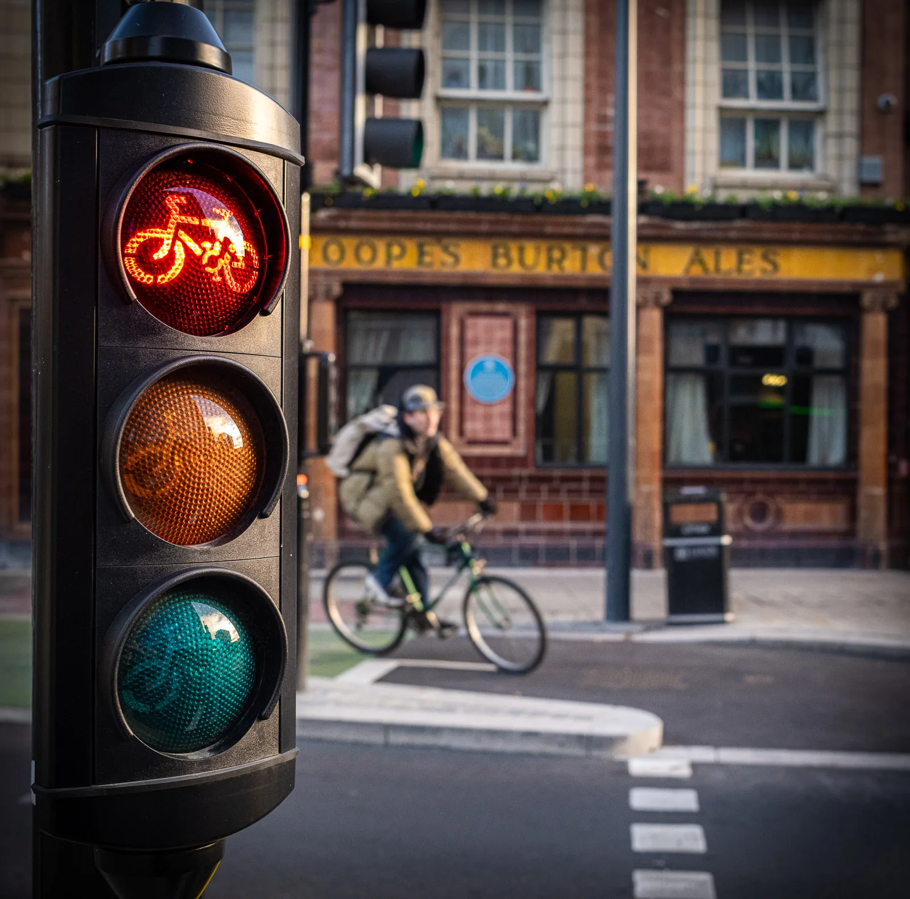
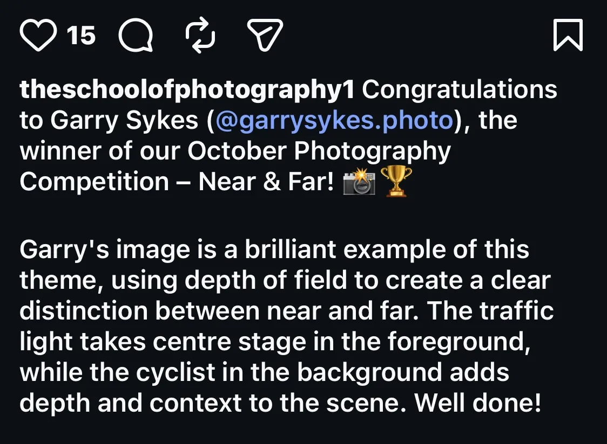

Who’d have thought, eh?

Just four months into my photographic journey and I’ve won a competition with a street photograph I captured in [Leeds](../../../projects/street-photography-leeds.qmd), UK.

After buying my [Fujifilm X100VI](https://www.fujifilm-x.com/en-gb/products/cameras/x100vi/) in July 2026, I spent many frustrating weeks trying to figure out how to use the damn thing.

Unfortunately, I made a classic schoolboy error and jumped straight into the endless stream of tutorials that all those pesky YouTubers were churning out. Before long, I was getting myself tied in knots with film simulations, recipes, JPEGs, Q-menus and other 'in-camera' wizardry. Needless to say, I was beginning to have doubts about my choices – and whether photography was right for me after all.

Thankfully, I’m not a complete newbie. About 20 years ago, I bought an entry-level DSLR ([Nikon D70](https://en.wikipedia.org/wiki/Nikon_D70)), along with a few cheap lenses. I got to grips with the basics and even developed some RAW editing skills. Alas, work and family commitments meant I didn’t have the time to pursue the hobby in any great depth, and it gradually fizzled out after a couple of years.

Another downside was that I really hated lugging around lots of heavy camera equipment when heading outdoors to take pictures. That explains my recent purchase of a small, lightweight, fixed-lens camera.

So, I had two choices: quit and sell the X100VI for more than I paid for it (it’s a highly sought-after ‘influencer’ camera, with little or no stock anywhere on the planet), or go back to basics and relearn photography from the ground up.

I chose the latter and enrolled at [The School of Photography](https://www.theschoolofphotography.com) (TSOP), which offers "structured online photography courses, tutorials, membership and an active learning community".

So far, I’ve completed the Beginners, Lightroom and Street Photography courses, and I’ve thoroughly enjoyed them. Going back to basics has meant abandoning all the fancy 'in-camera' JPEG wizardry for now and concentrating instead on shooting RAW, getting to grips with the exposure triangle, composition and post-processing.

TSOP also hosts a monthly photo competition, where their 5000+ members can submit entries based on a specified theme. October’s theme was ‘**Near and Far**’, and my winning entry is shown above (you can also [see it in the Leeds gallery](../../../projects/street-photography-leeds.qmd#photo=20261017-090102-DSCF0996)).

The shortlisted entries were amazing, and the result was nail-bitingly close. I WON BY JUST TWO POINTS 🎉

> [YouTube: Near and Far Review 2026](https://www.youtube.com/watch?v=tHWEg_u0fuA&t=3s)

Needless to say, I was buzzing when I heard the result ... it's a welcome confidence boost and reassurance that I may have some potential after all.

<!--
Images live in this folder. Convert LrC JPEGs from ~/Desktop/Lrc_JPEGs/blog/ with:
  uv run scripts/photos.py post-images 2026-11-13-quality-street-i-won-a-photo-competition
Then reference them relatively, e.g. .
A gallery photo can be used directly: 
-->
